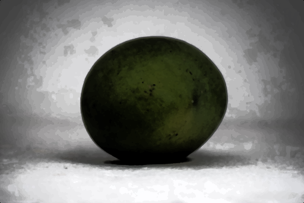
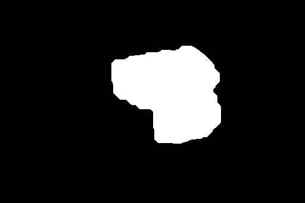
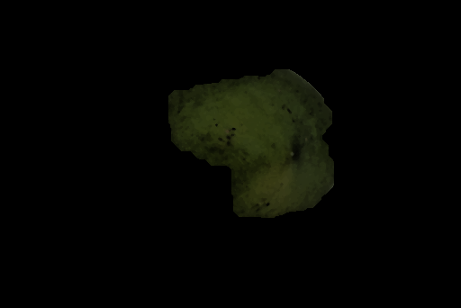
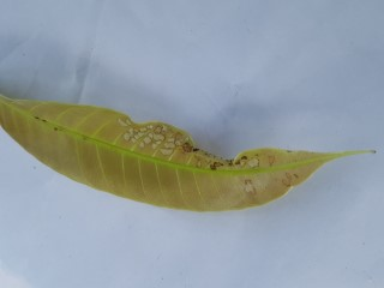
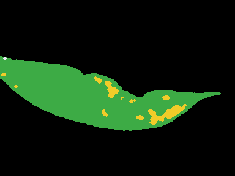
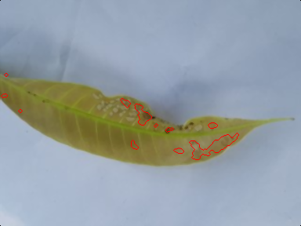

# CropVision: Crop Maturity and Health Assessment

### Project Description:
#### Summary - 
CropVision assesses **mango fruit maturity** and **mango leaf health** from a single still image using classical digital image processing. Two MATLAB pipelines do the analysis and a Streamlit dashboard shows every intermediate stage, so each result can be traced back to the image operations behind it.

- **Mango maturity** (`matlab/crop_pipeline.m`): resize, 3×3 median filter, histogram equalisation of V (HSV), k-means clustering in L\*a\*b\* with background and shadow rejection, Chan-Vese active contour, morphological clean-up and size-adaptive stem removal, then colour / texture / shape / DFT features. A linear SVM on the 9 colour features predicts **unripe, partially ripe or ripe**.
- **Leaf health** (`matlab/run_leaf_dashboard.m`): resize, 3×3 median filter, CLAHE on L\*, k-means segmentation of the leaf (with Otsu and sharpness-based fallbacks), morphology, pixel-wise tissue classification (healthy, chlorotic, necrotic, powdery, sooty), then 59 colour, texture, shape, granulometry and DFT features. An RBF SVM predicts **healthy or one of seven diseases**, and the lesion area gives the **affected-area %** and a **severity** band.

| Classifier | Data | 5-fold cross-validated accuracy |
|---|---|---|
| Mango maturity (9 colour features, linear SVM, used in the app) | 748 images, 3 classes | 91.8% |
| Leaf disease (59 features, RBF SVM, used in the app) | 150 images per class × 8 classes, plus field-style augmented copies, grouped folds | 95.0% |

#### Course concepts used - 
1. **Digital image fundamentals:** sampling (bilinear resize), gray-level quantisation for the GLCM, RGB / HSV / CIE L\*a\*b\* colour models, 8-connectivity, arithmetic and logical operations (masking, difference images).
2. **Image transforms:** 2-D DFT with `fftshift`, log-magnitude spectrum, radial DFT band-energy features.
3. **Enhancement and restoration:** histogram equalisation, CLAHE, log and min-max gray-level transforms, 3×3 median filtering for noise removal, ideal / Butterworth / Gaussian frequency-domain low-pass filters for comparison (`matlab/run_transforms.m`).
4. **Segmentation and morphology:** k-means clustering, Otsu thresholding, Chan-Vese active contour, Canny edges, opening, closing, hole filling, boundary extraction, granulometry and black top-hat.
5. **Colour image processing and description:** hue / saturation fractions, colour statistics, GLCM texture, local entropy, region shape descriptors.
   
#### Additional concepts used -
1. Support vector machines (linear and RBF) with error-correcting output codes, trained on standardised features and evaluated by 5-fold cross-validation.
2. Data augmentation (zoom, exposure, white balance, blur) to make the leaf model robust to field photos.
3. Streamlit dashboard connected to MATLAB through the MATLAB Engine for Python or a folder-watcher bridge (`matlab/watch_leaf.m`).
   
#### Dataset - 
- **MangoLeafBD** (8 classes × 500 images: Healthy, Anthracnose, Bacterial Canker, Cutting Weevil, Die Back, Gall Midge, Powdery Mildew, Sooty Mould). Mendeley Data: https://data.mendeley.com/datasets/hxsnvwty3r/1
- **Alphonso Mango Ripening Stage Classification Dataset** (unripe, partially ripe, ripe; 250 images each). Mendeley Data: https://data.mendeley.com/datasets/tyghd6gxw2/1

The full datasets are not in this repository because of their size. To retrain, place them in `dataset/MangoLeafBD/<Class>/` and `dataset/MangoRipeness/<stage>/` and run `matlab/run_training.m` and `matlab/run_mango_training.m`. The two trained models (`matlab/leaf_model.mat`, `matlab/mango_model.mat`) are included, so the app works straight after cloning.

`data/` holds 8 sample input images taken from these datasets (large mango photos were downscaled to 1600 px).

#### Novelty - 
1. **Two assessments in one system:** fruit maturity and leaf health share the same core ideas (L\*a\*b\* clustering, the object as the union of non-background clusters, chromaticity-based shadow rejection).
2. **Automatic background handling:** the colour spread of the image border selects border-and-shadow rejection or shape-based region scoring; the Chan-Vese result is accepted only if the area changes by less than 40%. Size-adaptive stem removal uses an opening scaled to the fruit's diameter.
3. **Pixel-wise tissue classification** into five classes, with granulometry and top-hat features describing lesion size, and an affected-area severity scale.
4. **Colour-only maturity model:** set-up-dependent features (shape, texture, lightness) are left out so the model also works on photos taken outside the dataset's studio set-up.
5. **Traceable results:** the dashboard shows every stage image, a "what changed" view per stage and the feature values behind each decision.
   
### Contributors:
1. Anshumanth (PES1UG24EC033)
2. Manogna (PES1UG24EC045)
3. Aryaa (PES1UG24EC254)

### Steps:
Requirements: MATLAB (R2026a used) with the Image Processing Toolbox and the Statistics and Machine Learning Toolbox, and Python 3.10 or newer.

1. Clone Repository
```
git clone https://github.com/DIP-2026-MINI-PROJECT/crop-maturity-health-assessment.git
cd crop-maturity-health-assessment
```

2. Install Dependencies
```
python -m venv venv
venv\Scripts\activate
pip install -r requirements.txt
```

3. Run the Code

Start the app:
```
python -m streamlit run app.py
```
On Windows you can also double-click `start_app.bat` (it expects the virtual environment in `.venv`). The app reaches MATLAB through the MATLAB Engine for Python if it is installed (`pip install matlabengine`); otherwise it starts the folder watcher in MATLAB, or you can start it yourself:
```
cd matlab
watch_leaf
```
Choose **Mango ripeness** or **Leaf disease** on the home screen, upload an image and click **Analyze image**.

To run a pipeline without the app, in MATLAB from the `matlab/` folder:
```
crop_pipeline('../data/mango_ripe.jpg', '../outputs/mango_ripe')
run_leaf_dashboard('../data/leaf_anthracnose.jpg', '../outputs/leaf_anthracnose')
```

### Outputs:
Each folder in `outputs/` holds every stage image for one input in `data/`, plus `results.json` with the features and the prediction.

* Important intermediate steps
  * Mango (`outputs/mango_*/`): `02_resized`, `03_denoised`, `04_enhanced`, `05_clusters`, `06_initial_mask`, `07_active_contour`, `08_mask`, and a `*_change` image showing what each step changed.
  * Leaf (`outputs/leaf_*/`): `resized`, `denoised`, `enhanced` (CLAHE), `colorspace_lab`, `clusters`, `cluster_union`, `opened`, `mask`, `lesion_map` (tissue classes), `lesion_mask`, `specks` (top-hat), `edges` (Canny).
* Final output images
  * Mango: `09_segmented.png` (segmented fruit) and the maturity stage in `results.json`.
  * Leaf: `segmented.png`, `overlay.png` (leaf boundary) and `lesion_overlay.png` (lesion outlines), with condition, affected area and severity in `results.json`.

Results for the 8 sample images:

| Input | True class | Predicted | Confidence | Affected area / severity |
|---|---|---|---|---|
| `mango_unripe.jpg` | Unripe | Unripe | 72.5% | – |
| `mango_partially_ripe.jpg` | Partially ripe | Partially ripe | 61.2% | – |
| `mango_ripe.jpg` | Ripe | Ripe | 55.7% | – |
| `leaf_healthy.jpg` | Healthy | Healthy | 99.1% | 20.0%, Moderate (glare flagged as lesion) |
| `leaf_anthracnose.jpg` | Anthracnose | Anthracnose | 87.9% | 7.4%, Mild |
| `leaf_powdery_mildew.jpg` | Powdery Mildew | Powdery Mildew | 99.3% | 7.8%, Mild |
| `leaf_sooty_mould.jpg` | Sooty Mould | Sooty Mould | 50.1% | 2.7%, Mild |
| `leaf_die_back.jpg` | Die Back | Die Back | 99.2% | 96.2%, Very severe |

These samples come from the training datasets, so they demonstrate the pipeline rather than measure accuracy; the cross-validated accuracies above are the accuracy figures.

| Mango: enhanced → mask → segmented | Leaf: input → tissue classes → lesion outlines |
|---|---|
|    |    |

### References:
1. R. C. Gonzalez and R. E. Woods, *Digital Image Processing*, 4th ed., Pearson, 2018.
2. Course slides, UE24EC342AC1 Digital Image Processing, Units 1–4, PES University, 2026.
3. S. I. Ahmed et al., "MangoLeafBD: A comprehensive image dataset to classify diseased and healthy mango leaves," *Data in Brief*, vol. 47, 108941, 2023. https://data.mendeley.com/datasets/hxsnvwty3r/1
4. A. Prabhu, *Alphonso Mango Ripening Stage Classification Dataset*, Mendeley Data, 2024. https://data.mendeley.com/datasets/tyghd6gxw2/1
5. N. Otsu, "A threshold selection method from gray-level histograms," *IEEE Trans. SMC*, vol. 9, no. 1, pp. 62–66, 1979.
6. T. F. Chan and L. A. Vese, "Active contours without edges," *IEEE Trans. Image Processing*, vol. 10, no. 2, pp. 266–277, 2001.
7. J. Canny, "A computational approach to edge detection," *IEEE Trans. PAMI*, vol. 8, no. 6, pp. 679–698, 1986.
8. R. M. Haralick, K. Shanmugam and I. Dinstein, "Textural features for image classification," *IEEE Trans. SMC*, vol. 3, no. 6, pp. 610–621, 1973.
9. K. Zuiderveld, "Contrast limited adaptive histogram equalization," in *Graphics Gems IV*, Academic Press, 1994, pp. 474–485.
10. C. Cortes and V. Vapnik, "Support-vector networks," *Machine Learning*, vol. 20, no. 3, pp. 273–297, 1995.
11. MathWorks, Image Processing Toolbox and Statistics and Machine Learning Toolbox documentation, R2026a. https://www.mathworks.com/help
12. Streamlit documentation. https://docs.streamlit.io
   
### Limitations and Future Work:
- Only visible surface characteristics are assessed, from still images; no treatment advice is given.
- The ripeness dataset uses a plain studio background, so maturity confidence is lower on cluttered field photos.
- Leaf photos taken in the field (on the tree, cut by the frame, or not mango leaves) get lower confidence; glare can be counted as lesion area.
- Thin, branched Cutting Weevil damage is hard to segment, because the opening erodes it.
- Confidence values are SVM posterior or soft-max scores, not calibrated probabilities.
- Future work: ground-truth masks to measure segmentation accuracy, a field-collected ripeness dataset, and CNN features (e.g. ResNet-18) compared against the classical features.

More detail on the leaf pipeline: [docs/LEAF_PIPELINE.md](docs/LEAF_PIPELINE.md).
